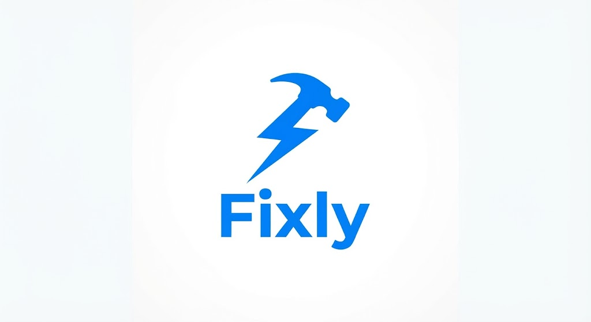

<div align="center">

  

  # Fixly

  **On-Demand Handyman & Skilled Artisan Marketplace**

  *Connecting clients with verified home service professionals, escrow payment protection, and field skill testing.*

  [](https://react.dev/)
  [](https://vitejs.dev/)
  [](https://tailwindcss.com/)
  [](https://www.typescriptlang.org/)
  [](https://firebase.google.com/)
  [](https://render.com/)

</div>

---

## 📖 Table of Contents

- [Overview](#-overview)
- [Key Features](#-key-features)
  - [Client Experience](#client-experience)
  - [Artisan / Pro Experience & Onboarding](#artisan--pro-experience--onboarding)
  - [Field & Service Skill Assessment System](#field--service-skill-assessment-system)
  - [Escrow & Mobile Money (MoMo) Protection](#escrow--mobile-money-momo-protection)
- [Architecture & Tech Stack](#-architecture--tech-stack)
- [Project Structure](#-project-structure)
- [Local Development Setup](#-local-development-setup)
- [Deployment Guide (Render / Vercel)](#-deployment-guide-render--vercel)
- [License](#-license)

---

## 💡 Overview

**Fixly** is a location-based home service and handyman marketplace engineered to solve trust, quality, and payment transparency in skilled trades. 

By integrating **National ID (Ghana Card) biometric liveness verification**, an **interactive technical skill assessment system**, and **escrow-backed payments**, Fixly ensures homeowners get reliable repairs while empowering verified artisans with automated Mobile Money (MTN MoMo / Telecel Cash) payouts.

---

## ✨ Key Features

### Client Experience
- **Live Search**: Dynamic character-by-character search filtering matching services in real-time.
- **Advanced Search Filters**: Refine pros by proximity radius (miles), minimum star rating, completed jobs count, Ghana Card verification status, and maximum hourly rates.
- **Popular Services Showcase**: Quick 1-tap booking for popular services (Furniture Assembly, Plumbing Fixes, AC & Split Servicing, Electrical Diagnostics).
- **Booking Confirmation & Tracking**: Clear arrival windows (`10:30 AM – 11:30 AM`), safety check indicators, and active job status updates.
- **Account Financial Summary**: Mini-dashboard displaying total amount spent, funds held in safe escrow, and completed visit counts.
- **Booking History & Receipts**: Complete record of past visits with downloadable digital receipts and 1-tap rebooking.
- **Profile Customization**: Edit contact details, service addresses, emergency contacts, and upload custom profile photos with live preview.

### Artisan / Pro Experience & Onboarding
- **Seamless Role Switching**: Easily switch between Client and Artisan mode from the account menu.
- **Pro Dashboard & Status Cockpit**: Tactile **ONLINE & READY** / **OFFLINE** toggle switch.
- **Mobile Money (MoMo) Wallet**: Track available cash balance, pending escrow funds, and total lifetime earnings with instant cashout to Mobile Money.
- **Quality Scorecard**: Displays artisan star rating, total completed jobs, on-time arrival rate, and problem resolution percentage.
- **Incoming Job Queue**: Real-time job dispatches with 1-tap **Accept** or **Decline** options.

### Field & Service Skill Assessment System
- **Multi-Step Onboarding**:
  1. **Field Selection**: Choose primary trade (*Plumbing, Electrical, Handyman, AC & Cooling, Painting & POP*).
  2. **Technical Skill Assessment**: Interactive 3-question diagnostic exam tailored to the chosen trade (testing thread sealants, circuit breaker load calculations, wall anchors, and regulations).
  3. **Score Calculation**: Real-time scoring with pass/fail thresholds (75%+ required) and detailed answer explanations.
  4. **Identity & Ghana Card Verification**: Biometric National ID authentication (`GHA-72019482-1`) and trade certificate upload.
  5. **Payout Setup**: Link Mobile Money wallet network for automated earnings payout.
- **Multi-Skill Accreditation**: Pros can take additional field assessments at any time to expand their service badge portfolio.

### Escrow & Mobile Money (MoMo) Protection
- 100% of service fees are held in Fixly Escrow upon booking.
- Funds are safely released to the artisan's wallet only after client sign-off confirming the job is solved.
- Direct automated cashout to **MTN Mobile Money**, **Telecel Cash**, or **AT Money**.

---

## 🛠 Architecture & Tech Stack

- **Frontend**: React 19, TypeScript, Vite 8
- **Styling**: Tailwind CSS v4, Lucide React Icons
- **State Management**: React Hooks & Context API
- **Database & Auth**: Firebase Firestore
- **Deployment Compatibility**: Render, Vercel, Netlify

---

## 📂 Project Structure

```
fixly/
├── public/
│   └── assets/
│       └── aistudio/
│           └── fixly_logo_a30be9f2.jpeg    # Official Fixly Logo
├── src/
│   ├── components/
│   │   └── handyman/
│   │       ├── BookingHistoryModal.tsx      # Past bookings & receipts
│   │       ├── BottomNavBar.tsx             # Fixed bottom navigation
│   │       ├── FixlyLogo.tsx                # SVG Fixly Logo Component
│   │       ├── GhanaCardBadge.tsx           # Verified National ID Badge
│   │       ├── HandymanApp.tsx              # Main container & screen router
│   │       ├── NotificationDrawer.tsx       # System notifications drawer
│   │       ├── ProfileSettingsModal.tsx     # Photo upload & account edit
│   │       ├── ProOnboardingModal.tsx       # Field skill test & onboarding
│   │       ├── ProProfileScreen.tsx         # Artisan dashboard & MoMo wallet
│   │       ├── Screen1Home.tsx              # Home screen with live search
│   │       ├── Screen2Categories.tsx        # Service categories grid
│   │       ├── Screen3Professionals.tsx     # Pro selection list with filters
│   │       ├── Screen4Confirmation.tsx      # Booking confirmation screen
│   │       ├── Screen5Profile.tsx           # Account screen & Switch to Pro
│   │       ├── Screen6Wallet.tsx            # Payment methods & balance
│   │       ├── SearchFilterModal.tsx        # Proximity & rating filter
│   │       └── types.ts                     # TypeScript interfaces
│   ├── App.tsx                              # App entry point
│   ├── main.tsx                             # Vite mount
│   └── index.css                            # Tailwind CSS import
├── .npmrc                                   # Legacy peer deps for Render
├── package.json                             # Dependencies & build scripts
├── index.html                               # HTML entry point with metadata
└── README.md                                # Project documentation
```

---

## 🚀 Local Development Setup

### Prerequisites
- **Node.js**: v18.0.0 or higher
- **npm** or **bun**

### Installation Steps

1. **Clone the repository**:
   ```bash
   git clone https://github.com/Sammireku/fixly.git
   cd fixly
   ```

2. **Install dependencies**:
   ```bash
   npm install
   ```

3. **Start the local development server**:
   ```bash
   npm run dev
   ```
   *The app will be available at `http://localhost:3000`.*

4. **Build for production**:
   ```bash
   npm run build
   ```

---

## 🌐 Deployment Guide (Render / Vercel)

### Deploying to Render
1. Connect your GitHub repository (`Sammireku/fixly`).
2. Set **Environment**: `Node`
3. Set **Build Command**: `npm install && npm run build`
4. Set **Publish Directory**: `dist`
5. Note: The repository includes a `/.npmrc` file with `legacy-peer-deps=true` to prevent dependency resolution conflicts during automated CI/CD builds.

---

## 📄 License

This project is licensed under the MIT License - see the LICENSE file for details.

<div align="center">
  <sub>Built with ❤️ for Fixly Ghana</sub>
</div>
